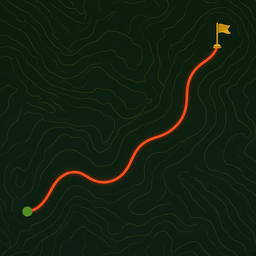
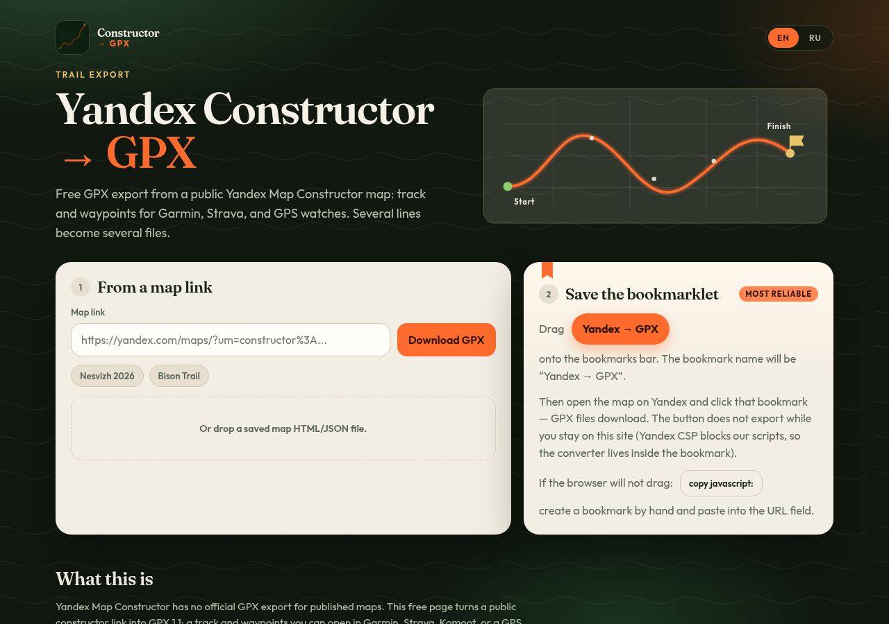

# Yandex Map Constructor → GPX



[Русский](README.ru.md) · **[Open the web app](https://mrdaila007.github.io/yandex-constructor-to-gpx/)**

Export a public [Yandex Map Constructor](https://yandex.com/map-constructor) map (`um=constructor:…`) to **GPX 1.1**: one track per line plus waypoints. Use it for trail races, OCR, orienteering, Garmin, Strava, Komoot, and other GPS apps.

Yandex has no official GPX export for published Constructor maps. This tool reads the `userMap` JSON already embedded in the public map page. Several distances on one map (3K / 5K / 10K) become several `.gpx` files.

[](LICENSE)
[](https://mrdaila007.github.io/yandex-constructor-to-gpx/)
[](#cli)

<p>
  <a href="https://mrdaila007.github.io/yandex-constructor-to-gpx/">
    
  </a>
</p>

Also searched as: Яндекс Конструктор карт GPX, экспорт трассы из конструктора, Yandex Maps constructor export GPX.

## Web app

**https://mrdaila007.github.io/yandex-constructor-to-gpx/** — English / Russian.

Three ways, from convenient to reliable.

### 1. Map URL

Paste a `yandex.com/maps` / `yandex.ru/maps` URL with `um=constructor:…` and click **Download GPX**.

The request goes through a public CORS proxy: Yandex will not send the map page directly to GitHub Pages. The proxy fails sometimes.

### 2. HTML or JSON file

On the map in the browser: Save as → HTML. Drop the file on the site. A `userMap` JSON dump works too.

### 3. Bookmarklet **Yandex → GPX** (most reliable)

Yandex CSP blocks scripts from `github.io`, so the bookmarklet is **self-contained**: the converter lives inside the bookmark.

1. Open the [export page](https://mrdaila007.github.io/yandex-constructor-to-gpx/).
2. Drag the **Yandex → GPX** button onto the bookmarks bar (that text becomes the bookmark name).
3. Open the constructor map on Yandex Maps.
4. Click the bookmark — `.gpx` files download.

If the browser will not drag: click **copy javascript:**, create a bookmark named `Yandex → GPX`, paste into the URL field.

Clicking the button while still on GitHub Pages does nothing useful. Export only works on the Yandex map page.

## CLI

Python 3.10+ (stdlib only).

```bash
git clone git@github.com:MrDaila007/yandex-constructor-to-gpx.git
cd yandex-constructor-to-gpx
ln -sf "$(pwd)/scripts/constructor_to_gpx.py" ~/.local/bin/yandex-constructor-gpx
```

For the Cursor skill: clone or symlink into `~/.cursor/skills/yandex-constructor-to-gpx`.

```bash
yandex-constructor-gpx 'https://yandex.com/maps/?um=constructor%3A...' -o ./gpx

# one track → one file
yandex-constructor-gpx 'URL' -o ~/Downloads/route.gpx

# several lines → prefix-3k.gpx, prefix-5k.gpx, ...
yandex-constructor-gpx 'URL' -o ~/Documents --prefix bison-trail-2026

# raw map JSON
yandex-constructor-gpx 'URL' -o ./out --save-json ./usermap.json
```

Source: URL, constructor id (64 hex), saved HTML, or JSON.

`--chrome` — headless Chrome fallback if the HTML has no `userMap`.

## GPX contents

| What | Source | Coordinates |
|------|--------|-------------|
| Map title | `userMap.title` | |
| Waypoints | `type: placemark` | `[lon, lat]` |
| Tracks | `type: line` → `LineString` | `[lon, lat]` |

GPX uses `lat, lon`. Names **Старт / Финиш / Питьевой пункт** (Start / Finish / Aid station) are unnumbered (Start/Finish may sit in `subtitle` while `title` is `S`/`F`). Other placemarks are numbered as in the constructor sidebar.

## FAQ

**Does it work on private maps?** No. The map must be a public Constructor link (`um=constructor:…`).

**Why does paste-URL sometimes fail?** GitHub Pages cannot fetch Yandex directly (CORS). Use a saved HTML file or the bookmarklet.

**Can I import the file into Garmin / Strava?** Yes. GPX 1.1 with a track and waypoints is the usual format those apps accept.

**Is this an official Yandex tool?** No. It only reads data already present on the public map page.

## Checked on

- [Nesvizh 2026](https://yandex.com/maps/?um=constructor%3Afbd12684307cb322481c9e279ba4e3cd969a565ab626ec9ecb92fc2b36949e83) — 23 waypoints, 135 track points
- [Bison Trail 18.10.2026](https://yandex.com/maps/?um=constructor%3Aaf3b2c797a2526fe5b2a9971ff9e4886428b32275259e851d19a9b778c22fe48) — 3K / 5K / 10K

## License

[MIT](LICENSE)
